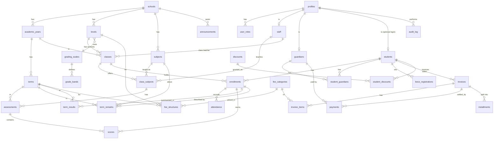

# ERD: Pinks Academy (v0 draft)

Scope drives the design: Pinks Academy has creche, nursery 1-2, KG 1-2 and Basic 1-9. Sized for up to 678 students and 48 staff (tiny for Postgres, so no sharding concerns). They record everything on paper today, so the first value is **record keeping, an overview of the school, and analytics**. Fees use cash, mobile money (all networks) and bank transfer, with customisable categories (admission, school fees, books and stationery).

Conventions (from `DECISIONS.md`):
- Every table has `school_id` and an RLS policy. Every table has `id uuid`, `created_at`, `updated_at`.
- Soft-delete (`deleted_at`) on people and financial records; never hard-delete them.
- Sensitive tables are audit-logged (see `audit_log`).
- Business rules (grade computation, balances) are computed in the database or server code, not in the client.

## Diagram

## Tables

### Tenancy and access
| Table | Key columns | Notes |
|---|---|---|
| `schools` | name, logo_url, brand colours, timezone, currency (GHS) | One row for Pinks Academy now; the tenant root later. |
| `profiles` | id (= Supabase `auth.users.id`), school_id, full_name, phone, email | One per login. Linked to `staff`, `guardians` or `students` where relevant. |
| `user_roles` | profile_id, role | Roles: `super_admin`, `school_admin`, `principal`, `teacher`, `hr_officer`, `accountant`, `librarian`, `receptionist`, `parent`, `student`. A user may hold several. |
| `audit_log` | actor, action, table, row_id, before, after, at | Insert-only. No update or delete policy. |

### School structure
| Table | Key columns | Notes |
|---|---|---|
| `academic_years` | name, start, end, is_current | |
| `terms` | academic_year_id, name, start, end, is_current | |
| `levels` | name, order, grading_scale_id, sits_bece (bool) | Creche, Nursery 1-2, KG 1-2, Basic 1-9 (16 rows). `order` drives promotion. |
| `classes` | level_id, academic_year_id, section (free text), class_teacher_id | A class is a level + section for one year. Sections are created by the admin per level and year (one, A/B/C, or any names), so nothing is fixed in code. |
| `subjects` | name, code, is_active | Fully customisable by the admin (add, rename, retire). One list for subjects and creche to KG 2 learning areas: the level's grading scale decides whether a subject is scored or gets a written remark. |
| `class_subjects` | class_id, subject_id, teacher_id | Who teaches what; also the basis for teacher-scoped permissions. Handles the mixed model: in lower levels the class teacher is assigned every subject, in upper levels each subject has its own teacher. |
| `number_sequences` | school_id, kind (`admission_no`, `staff_no`, `receipt_no`, `invoice_no`), format, year (nullable), next_value | Own numbering scheme, configurable per school. Numbers are issued atomically to avoid duplicates and are never reissued. Default for `admission_no`: format `V/{YYYY}/{NNNN}`, for example `V/2026/0001`. The year is the admission year, and the counter restarts at 1 each year (one row per kind and year). |

### People
| Table | Key columns | Notes |
|---|---|---|
| `students` | admission_no, first/middle/last name, dob, gender, photo_url, status (`active`/`completed`/`left`), admitted_on, left_on, left_reason, medical_notes | `admission_no` is the student's single school number (admission number and school ID in one). It is issued from `number_sequences` and never changes on promotion. It stays with the student until they complete or leave, is unique per school, and is never reused, even after the student is gone. |
| `bece_registrations` | student_id, exam_year, index_number (nullable), entered_by, entered_on | Placeholder for final-year students. The school enters the BECE index number when it is issued, so it starts empty. One row per student per exam year. Only students in a level with `sits_bece = true` get one. |
| `guardians` | name, phone, email, relationship, occupation, address | |
| `student_guardians` | student_id, guardian_id, is_primary, can_pickup | Many-to-many. Siblings share guardians. |
| `staff` | staff_no, name, role_title, type (`teaching`/`non_teaching`), phone, hired_on, status | 48 rows. Payroll, contracts and leave are deferred. |
| `enrollments` | student_id, class_id, academic_year_id, status | Student-in-class for a year. The history that makes analytics and promotion possible. |

### Attendance and grading
| Table | Key columns | Notes |
|---|---|---|
| `attendance` | enrollment_id, date, status (`present`/`absent`/`late`/`excused`), marked_by, note | Unique on (enrollment_id, date). Taken once a day per class. |
| `grading_scales` | name, type (`ges_numeric`/`custom_numeric`/`descriptive`/`checklist`) | |
| `grade_bands` | scale_id, min, max, grade, remark | GES 1-7 seeded from the blueprint: 80-100 = 1 (Excellent) down to 0-29 = 7. |
| `assessments` | class_subject_id, term_id, type (`class_exercise`/`homework`/`project`/`ca_test`/`exam`), max_score, weight | CA components feed the 30% CA; the exam is 70%. |
| `scores` | assessment_id, enrollment_id, score | |
| `term_results` | enrollment_id, term_id, subject_id, ca_total, exam_score, total, grade, remark | Numeric levels only. Computed from `scores` by a trigger when `grading_type = ges_numeric`. Source for report cards and analytics. |
| `term_remarks` | enrollment_id, term_id, subject_id (nullable), remark, written_by | Descriptive levels (creche to KG 2): a written remark per subject (learning area), plus an overall teacher remark when `subject_id` is null. Basic levels also use it for the class teacher and head teacher comments on report cards. |

Grading by level: creche, nursery 1-2 and KG 1-2 use a `descriptive` scale (written remarks, no numbers). Basic 1-9 use `ges_numeric`. `levels.grading_scale_id` makes this configuration, not code.

### Finance
| Table | Key columns | Notes |
|---|---|---|
| `fee_categories` | name, kind, is_one_off | Customisable. Seed: Admission (new students, one-off), School fees (per term), Books and stationery. |
| `fee_structures` | fee_category_id, level_id, term_id (nullable for one-off), amount | Price per category per level. |
| `discounts` | name, type (`percent`/`fixed`), value, applies_to_category_id (nullable), reason | Optional discount types, for example sibling or staff child. The school decides whether to use any. |
| `student_discounts` | student_id, discount_id, academic_year_id, approved_by | Which student gets which discount, for which year. Applied automatically when invoices are generated. |
| `invoices` | student_id, term_id, number, issued_on, due_on, status (`unpaid`/`partial`/`paid`/`void`) | |
| `invoice_items` | invoice_id, fee_category_id, kind (`fee`/`discount`/`arrears`), source_invoice_id, description, amount | A discount is a negative item. Unpaid balances carry across terms as an `arrears` item that points to the invoice it came from, so the history stays traceable. |
| `installments` | invoice_id, due_on, amount | Optional payment schedule for parents paying in instalments. A payment is matched to the invoice, and the schedule shows what is overdue. |
| `payments` | invoice_id, amount, method (`cash`/`mobile_money`/`bank_transfer`), network (`mtn`/`telecel`/`airteltigo`), reference, paid_on, received_by, paid_by_guardian_id | Receipt number generated per payment. Balance = invoice total - sum of payments. |

### Communication
| Table | Key columns | Notes |
|---|---|---|
| `announcements` | title, body, audience (`all`/`staff`/`parents`/class_id), posted_by, published_at | Notice board. |

## What this supports for the stated priorities

**Record keeping:** students, guardians, staff, enrollments, attendance, scores and payments, all with history by year and term.

**Overview and management** (dashboard widgets): total students by level and gender; staff count; attendance today and this week; fees billed, collected and outstanding; pending items.

**Analytics:** attendance rate by class and term; grade distributions and averages per subject and class; per-student trend across terms; fee collection by category, method and level; later, at-risk scoring (grade < 50 in 2+ subjects, attendance < 75%, declining trend).

## Decisions from Pinks Academy
1. Creche to KG 2 use descriptive remarks; Basic 1-9 use GES 1-7.
2. Admission numbers use our own scheme: `V/{YYYY}/{NNNN}` (for example `V/2026/0001`), with the counter restarting each year, configurable via `number_sequences`.
3. The admission number is also the school ID number: one number per student. It is permanent until the student completes or leaves, and is never reused.
4. Sections are customisable per level and year.
5. Fee discounts are supported but optional.
6. Fees can be paid in instalments, and unpaid balances carry across terms as arrears.
7. Class teachers cover all subjects in lower levels; upper levels have subject teachers (both modelled by `class_subjects`).
8. Subjects and learning areas are one customisable list, with the default KG learning areas seeded as subjects. Each class has its own subject list (a subject may start at a later level).
9. Final-year students (Basic 9 only) get a BECE index number field, blank until the school enters it.

## Still open
- The real subject and learning-area names on the Pinks Academy report card, if they differ from the defaults. Editable in Settings.

## Not in this draft (deferred)
Timetable, staff attendance, leave, payroll, recruitment, e-admission, library, assets, behaviour and discipline, internal messaging. Each adds tables later without changing the ones above.
